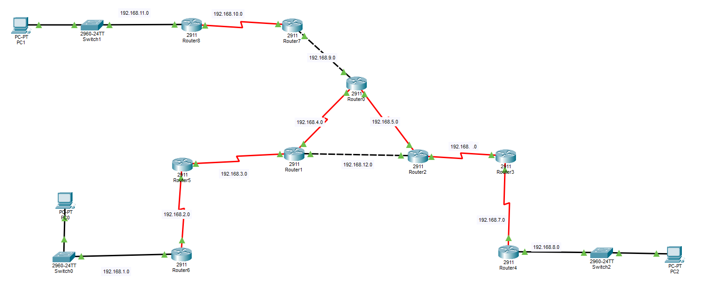

# Laboratório de Roteamento OSPF — Cisco Packet Tracer
<p align="center">
  
</p>
## Visão geral

Este projeto consiste em um laboratório de redes desenvolvido no **Cisco Packet Tracer** com o objetivo de estudar e praticar a configuração do **OSPF (Open Shortest Path First)**, um protocolo de roteamento dinâmico utilizado para trocar informações de roteamento entre roteadores.

A topologia é composta por múltiplos roteadores Cisco, switches, computadores e diferentes redes IPv4 interconectadas. O objetivo é explorar como os roteadores aprendem rotas para redes remotas e encaminham pacotes através de uma infraestrutura com múltiplos dispositivos.

## Objetivos do projeto

- Praticar a configuração de dispositivos Cisco por meio da CLI (Command-Line Interface).
- Compreender os fundamentos do roteamento dinâmico.
- Configurar e estudar o funcionamento do protocolo OSPF.
- Trabalhar com endereçamento IPv4 e identificação de sub-redes.
- Compreender como os roteadores trocam informações de roteamento.
- Inspecionar tabelas de roteamento e relacionamentos entre vizinhos OSPF.
- Testar a conectividade entre dispositivos em redes distintas.
- Desenvolver habilidades de diagnóstico e resolução de problemas em topologias com múltiplos roteadores.

## Topologia da rede

A topologia contém múltiplos roteadores interconectados, dois switches de acesso e computadores conectados a diferentes redes locais (LANs).

A infraestrutura inclui diversos enlaces entre roteadores, formando uma topologia com múltiplos segmentos de rede IPv4.

Os principais componentes são:

- **Roteadores Cisco 2911:** interligam as diferentes redes IPv4 e participam do roteamento.
- **Switches Cisco 2960:** fornecem conectividade de camada 2 nas redes locais.
- **Computadores:** funcionam como dispositivos finais para os testes de conectividade.
- **OSPF:** protocolo de roteamento dinâmico estudado e configurado no laboratório.

### Diagrama da topologia


*O diagrama representa a topologia do laboratório e as redes IPv4 que interligam os roteadores e os dispositivos finais.*

## Tecnologias e conceitos utilizados

| Tecnologia | Finalidade |
|---|---|
| Cisco Packet Tracer | Simulação da infraestrutura de rede |
| Cisco IOS CLI | Configuração e verificação dos dispositivos |
| IPv4 | Endereçamento de rede |
| OSPF | Roteamento dinâmico |
| Ethernet | Conectividade de rede local |
| Tabelas de roteamento | Consulta e verificação de rotas |

## Etapas de configuração

O laboratório segue um fluxo de configuração e verificação de rede:

1. **Análise da topologia:** identificar as conexões entre roteadores, switches e computadores.
2. **Configuração do endereçamento IPv4:** atribuir endereços IP e máscaras de sub-rede às interfaces e aos dispositivos finais pertinentes.
3. **Ativação das interfaces:** configurar as interfaces necessárias dos roteadores e verificar seu estado operacional.
4. **Configuração do OSPF:** habilitar o processo de roteamento e anunciar as redes apropriadas.
5. **Verificação do OSPF:** inspecionar as relações de vizinhança e as rotas aprendidas.
6. **Testes de conectividade:** utilizar `ping` e `traceroute` para verificar a comunicação entre diferentes redes.
7. **Diagnóstico de problemas:** investigar endereçamento, estado das interfaces, formação de vizinhanças e possíveis falhas de roteamento.

## Comandos úteis da CLI Cisco

Os comandos a seguir auxiliam na verificação e na resolução de problemas durante o laboratório.

### Verificação das interfaces

```text
show ip interface brief
```

Exibe os endereços IP e o estado operacional das interfaces do roteador.

### Tabela de roteamento

```text
show ip route
```

Exibe a tabela de roteamento. As rotas aprendidas por OSPF normalmente são identificadas pelo código `O`.

### Vizinhos OSPF

```text
show ip ospf neighbor
```

Exibe informações sobre os vizinhos OSPF e o estado das adjacências.

### Informações dos protocolos de roteamento

```text
show ip protocols
```

Exibe informações sobre os protocolos de roteamento ativos e suas configurações.

### Interfaces OSPF

```text
show ip ospf interface brief
```

Apresenta um resumo das interfaces participantes do OSPF, quando o comando é suportado pela versão do IOS utilizada.

### Testes de conectividade

```text
ping <ip-de-destino>
traceroute <ip-de-destino>
```

O comando `ping` verifica a conectividade com o destino, enquanto `traceroute` ajuda a identificar o caminho percorrido pelos pacotes na rede.

## Como utilizar o projeto

1. Instale e abra o Cisco Packet Tracer.
2. Clone ou baixe este repositório.
3. Abra o arquivo `.pkt` no Cisco Packet Tracer.
4. Examine a topologia e as configurações dos roteadores.
5. Utilize a CLI para consultar a configuração do OSPF e executar os comandos de verificação.
6. Realize testes de conectividade entre os computadores conectados às diferentes redes.

## Estrutura dos arquivos

```text
ospf-routing-lab/
├── README.md
├── topology.png
└── ospf-routing-lab.pkt
```

- `README.md` — documentação do projeto.
- `topology.png` — imagem da topologia da rede.
- `ospflab.pkt` — arquivo do projeto no Cisco Packet Tracer.

## Observações

Este projeto é uma simulação educacional de infraestrutura de redes, desenvolvida para praticar conceitos de roteamento dinâmico, configuração de equipamentos Cisco e diagnóstico de conectividade em um ambiente controlado.
